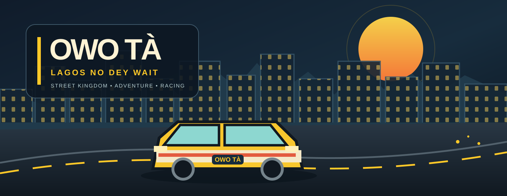
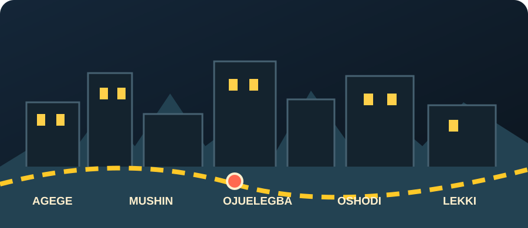
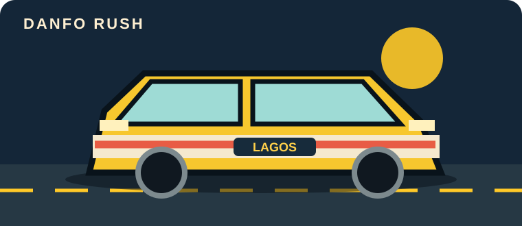
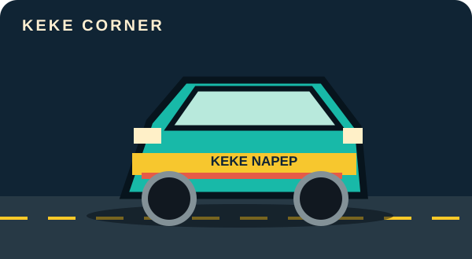
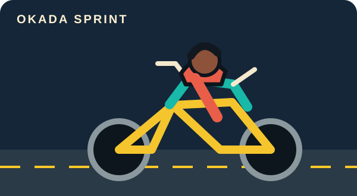
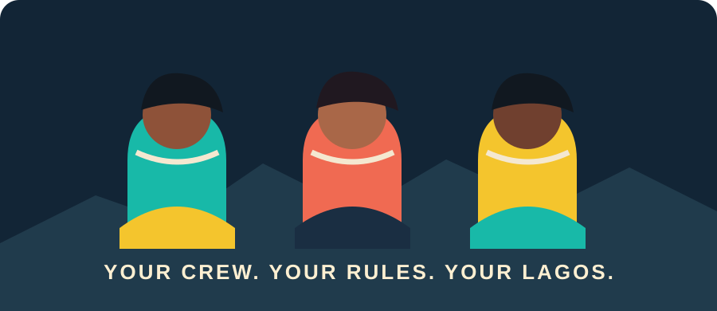
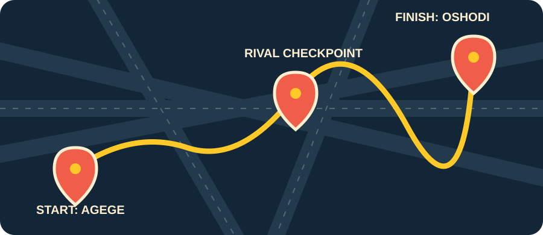
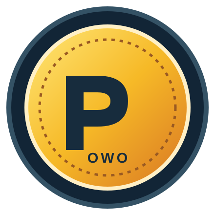
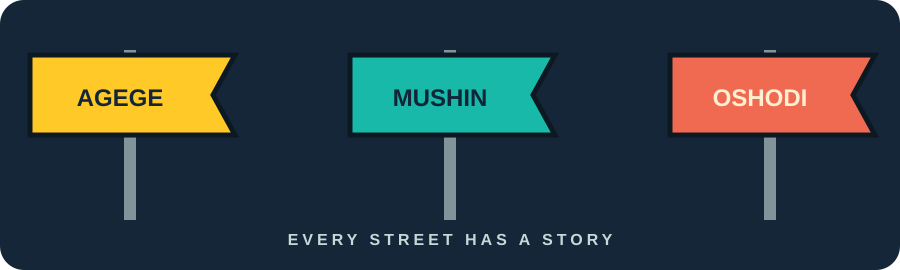

# OWO TÀ

<p align="center">
  
</p>

<p align="center">
  
  
  
  
  
</p>

<p align="center">
  <strong>LAGOS NO DEY WAIT.</strong><br/>
  Find your lane. Build your name. Own your street.
</p>

OWO TÀ is an Android-first, third-person 3D adventure and racing game inspired by the energy, movement, humour, and street culture of Lagos, Nigeria. This is a growing street kingdom: from danfo-filled junctions and market roads to the bright skyline and fast lanes of the island.

**This repository is the source of truth for the game.** The visuals below are original README illustrations that establish the intended art direction. They are not screenshots or claims that these features are already playable. The current playable build remains an early greybox prototype, as described in [Development status](#current-development-status).

## Product direction

The game world is inspired by Lagos districts and street life, including fictionalized versions of Ojuelegba, Oshodi, Agege, Mushin, Lekki, and Victoria Island.

Planned gameplay includes:

- Third-person exploration, walking, running, jumping, and interaction.
- Driving and racing vehicles such as danfo buses, keke, okada, taxis, and private cars.
- Missions, rival crews, crew recruitment, district progression, and unlockable areas.
- A virtual currency called **OWO**, upgrades, vehicle and character customization, and leaderboards.
- Multiple playable Nigerian male and female characters, with distinct 3D models, clothing, animations, and gameplay attributes.
- Living streets with traffic, pedestrians, markets, transport hubs, vendors, shops, changing lighting, and weather.
- Nigerian Pidgin dialogue, Lagos humour, and original music.

These are product goals, not claims that every feature is already implemented. Work is delivered in verified phases.

## The Lagos look

OWO TÀ should feel unmistakably Lagos: bold street signage, warm sodium lights, wet asphalt reflections, danfo yellow, market colour, concrete textures, expressive characters, and a city that never feels asleep.

<p align="center">
  
</p>

### The visual language

| Identity element | Direction |
| --- | --- |
| **Night asphalt** | `#101820` · deep charcoal foundations and road surfaces |
| **Lagos yellow** | `#FFC928` · danfo energy, route markers, highlights |
| **Street teal** | `#18B9A8` · transport details and interface accents |
| **Signal coral** | `#F06A52` · mission alerts, rival markers, emphasis |
| **Warm cream** | `#FFF0D2` · readable type and sign lettering |
| **City blue** | `#142638` · night sky, panels, and skyline depth |

The intended finish is **stylized premium 3D**: expressive, detailed, colourful, and readable on mid-range Android phones. The README art is a brand direction, not a substitute for the real 3D models, environments, lighting, and gameplay assets that will be built in Godot and Blender.

### Streets, rides, and the crew

<table>
  <tr>
    <td width="50%" align="center">
      
      <strong>DANFO RUSH</strong><br/>Own the yellow lane.
    </td>
    <td width="50%" align="center">
      
      <strong>KEKE CORNER</strong><br/>Small ride. Big city energy.
    </td>
  </tr>
  <tr>
    <td width="50%" align="center">
      
      <strong>OKADA SPRINT</strong><br/>Cut through the rush.
    </td>
    <td width="50%" align="center">
      
      <strong>YOUR STREET CREW</strong><br/>Different faces. Different stories.
    </td>
  </tr>
</table>

### Your route. Your reputation. Your OWO.

<table>
  <tr>
    <td width="50%" align="center">
      
      <strong>MISSION ROUTES</strong><br/>Take on checkpoints, rival crews, and district challenges.
    </td>
    <td width="50%" align="center">
      
      <strong>OWO CURRENCY</strong><br/>Earn, upgrade, customize, and progress.
    </td>
  </tr>
</table>

<p align="center">
  
</p>

<sub>All nine SVGs in this section are original vector illustrations created for the OWO TÀ README. They are brand and world-building concepts, not representations of completed in-game content.</sub>

## Ownership and project constraints

- The canonical repository is [Olori24/Owo-Ta](https://github.com/Olori24/Owo-Ta).
- The repository owner retains control of the source, assets, history, commercial direction, and releases.
- No proprietary game-generation platform is required for the core project.
- No paid service, asset, API, or build resource may be introduced without explicit approval.
- Never commit passwords, API keys, signing keys, tokens, or other secrets.
- Use original assets or assets with verified licenses that permit the intended use.
- Record third-party assets, attribution, license terms, and source in the asset and license registers.
- Preserve useful project history. Do not replace or rewrite unrelated work to make a task appear complete.

## Technology

- **Godot 4.3 stable** for the game engine and GDScript.
- **Blender** for original 3D models, rigs, animation, and asset preparation.
- **GitHub** for source control, issues, pull requests, and project coordination.
- **GitHub Actions** for automated validation and reproducible Android builds.
- **Android APK/AAB** for device testing and distribution.

Godot is suitable for the core game, but a successful headless test is not proof of visual quality or real-device performance. Codespaces can support code and automated validation; it is not assumed to be a dedicated GPU workstation for Blender or real-time 3D authoring.

## Current development status

**Phase 001: Godot foundation** has been merged into `main`.

**Phase 002: First playable 3D district and mobile controls** is proposed in [PR #3](https://github.com/Olori24/Owo-Ta/pull/3) and has not yet been merged. The playable greybox exists on that PR branch, not in the current `main` checkout. It contains a 3D district blockout, placeholder player, third-person camera, movement, jumping, and touch controls. It is not final art and does not yet contain the full Lagos world, production character models, vehicles, or missions.

The latest verified Phase 002 commit is `b7604ebe5343dfda3c9797cb4f50f697b0eef4f6`. Godot validation and the Android debug export both passed for that exact commit, and a verified APK artifact was uploaded. The APK has not yet been confirmed as installed and tested by the project owner on a physical Android device.

## Development roadmap

Delivery is organized as vertical slices. Each phase must produce a working, testable increment before scope expands.

1. **Foundation:** Godot project structure, startup scene, validation, Android export configuration, licensing and engineering rules. Completed.
2. **3D gameplay foundation:** one greybox district, third-person movement, camera, jump, and mobile controls. In review.
3. **First production character:** a real rigged and animated 3D Nigerian character, replacing the capsule placeholder, with an inspectable character-selection experience. Must use a real mesh, materials, skeleton, and animation assets.
4. **Playable district slice:** build out one district with initial traffic, pedestrians, interactable locations, vehicles, and a small set of missions.
5. **Progression systems:** OWO currency, upgrades, character and vehicle customization, crew and district progression.
6. **Expansion and optimization:** additional districts, characters, missions, content, and performance improvements; multiplayer only after the core single-player experience is stable.

Phase scope and acceptance evidence should be recorded in the relevant GitHub issue and pull request. Do not mark a phase complete based on a plan, generated image, code-only placeholder, or agent summary.

## Parallel development workflow

The project uses **issue-led, branch-isolated parallel work** so the project owner, ChatGPT, and the owner's coding agent can make progress at the same time without overwriting each other's changes.

### 1. Create a scoped task

Every independent task starts with a GitHub issue containing:

- A specific outcome and why it matters.
- Exact files or subsystems in scope.
- Explicit files and systems that must not be changed.
- Dependencies and the branch or commit to start from.
- Acceptance criteria and required verification evidence.
- A named owner: project owner, documentation/coordinator, or coding agent.

Split work when two tasks need to modify the same files or depend on each other's unfinished changes. Do not give two agents write ownership of the same file at the same time.

### 2. Assign work in parallel

Use separate workstreams with separate branches:

- **Project owner:** product decisions, priorities, approvals, visual inspection, and real-device testing.
- **Documentation and coordination:** README, architecture and workflow documentation, task decomposition, cross-branch integration, and evidence review.
- **Coding agent:** a bounded implementation or verification issue, with its own branch and pull request.

The coding agent must be explicitly assigned or invoked through the available agent workflow. Creating an issue alone does not mean an agent has started work. If an agent cannot be assigned, keep the issue ready and report that limitation rather than claiming dispatch.

### 3. Keep branches isolated

- Never have parallel workers push to the same branch.
- Use one branch per task, for example `feature/<task-name>`, `fix/<task-name>`, or `docs/<task-name>`.
- Start from the agreed base branch and record the starting commit in the issue.
- Do not force-push, rewrite shared history, or overwrite another worker's changes.
- Keep pull requests focused. Do not mix unrelated documentation, gameplay, and build-pipeline changes.
- If a task discovers a dependency or overlapping file, stop that part and coordinate before editing.

### 4. Integrate through pull requests

Each workstream opens a pull request that includes:

- What changed and what did not change.
- The issue it addresses.
- The exact commit SHA.
- CI and test results for that exact SHA.
- Screenshots, recordings, APK artifacts, or device observations when relevant.
- Known limitations, deferred work, and asset/license information.

Review changes against the task's acceptance criteria. Resolve critical and high-severity findings before merge. A green check on an earlier commit does not validate a later commit. Keep changes unmerged until the project owner approves integration.

### 5. Verify the actual product

Use the appropriate evidence for each type of change:

- **Code:** automated tests, static checks, and Godot headless validation.
- **3D scenes and assets:** load in Godot, inspect the actual scene/model, verify materials, rigging, collision, and animation.
- **Android builds:** confirm the APK/AAB was exported from the exact commit, verify the artifact, install it, and test on a physical Android device.
- **Gameplay:** test the real controls, collisions, interactions, and expected outcomes.
- **Third-party assets:** verify license and attribution before merging or shipping.

Report what was tested and what remains untested. Never turn an unverified assumption into a completion claim.

### 6. Close the loop

After integration, update the issue and project documentation with the merged commit, evidence, and remaining work. Rebase or branch the next task from the newly agreed integration point. Keep the task board and README status consistent with GitHub.

## Quick validation

Make the validation script executable and run the repository checks:

```bash
chmod +x scripts/*.sh
./scripts/validate_project.sh
```

For engine-level validation, install the pinned Godot 4.3 stable editor and matching export templates, then run:

```bash
godot --headless --editor --path . --quit
godot --headless --path . --script res://scripts/ProjectValidation.gd
```

A successful project validation confirms the configured project and scenes pass the checks implemented by the validator. It does not prove Android export, visual quality, or device performance.

## Android export setup

A fresh checkout needs all of the following before local Android export:

1. Install the Godot 4.3 stable editor.
2. In Godot's **Editor > Manage Export Templates**, install the matching 4.3 stable export templates.
3. The **Android Debug APK** preset uses the standard template. For the **Android Release AAB** preset, install the matching Android Gradle build template into this project with Godot's `--install-android-build-template` command.
4. Install JDK 17 and Android SDK command-line tools, platform-tools, Android 34 platform, and build-tools 34.0.0.
5. Set `JAVA_HOME` and `ANDROID_HOME` (or `ANDROID_SDK_ROOT`) in the shell. In Godot Editor, configure the Java SDK and Android SDK paths under **Editor Settings > Export > Android**.
6. Run `scripts/build_android.sh` to create the debug APK. The script checks prerequisites and installs the project Gradle build template for future AAB export; it does not install Java, the Android SDK, or the editor export templates.

The GitHub Actions workflow provisions the required tools and uploads a debug APK artifact when triggered by its configured events. Only a completed export workflow with a verified artifact proves that an APK was produced. A passing project-validation job alone is not an Android build.

## Project documentation

- [Engineering foundation](docs/engineering-foundation.md)
- [Branching and contribution rules](docs/branching-and-contribution.md)
- [Asset inventory](docs/asset-inventory.md)
- [License register](docs/license-register.md)
